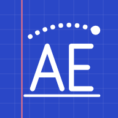
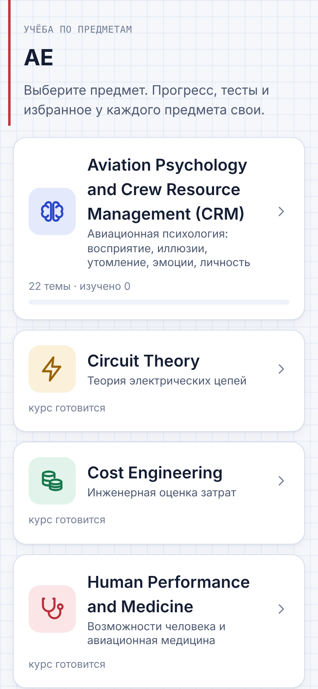
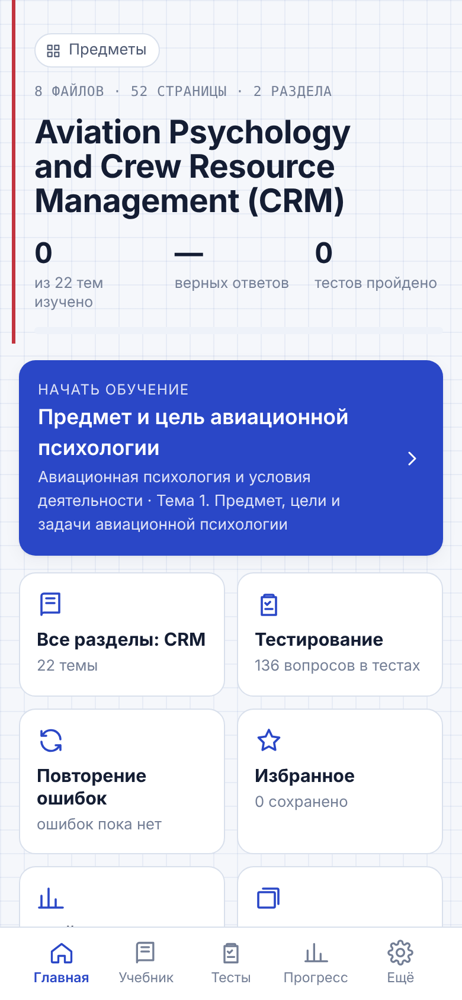
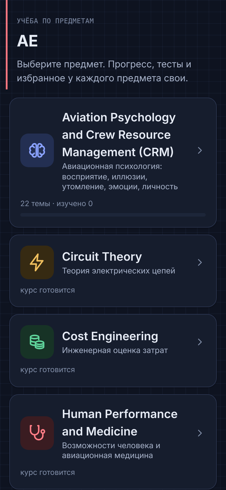
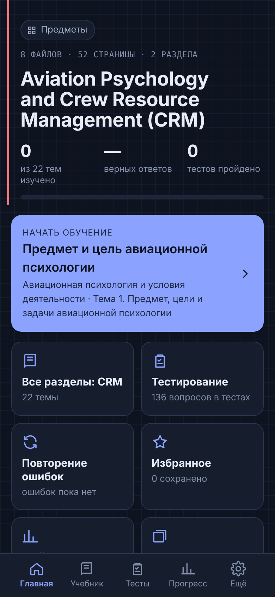

<div align="center">



# AE

**Учебное приложение по предметам курса — теория, формулы, анимации и тесты в одном месте**


### [▶ Открыть приложение в браузере](https://usmonovich.github.io/AE/)

<sub>Работает на компьютере, Android и iPhone. На телефоне: «Поделиться» → «На экран „Домой“» — и приложение откроется как обычное.</sub>

</div>

---

## О проекте

AE — приложение с тем же интерфейсом, что и [UTC Preparation](https://github.com/usmonovich/utc-preparation), но для многих предметов. На стартовом экране выбираешь предмет; у каждого предмета своя учебная база, свой прогресс, тесты и избранное. Предметы задаются списком в `content/subjects.json` и наполняются постепенно — по мере того как появляются материалы.

| | Предмет | Состояние |
|---|---|---|
| 🧠 | Aviation Psychology and Crew Resource Management (CRM) | темы 1–8 из 14: 22 темы, 136 вопросов, 3 анимации — утверждено и опубликовано |
| ⚡ | Circuit Theory | курс готовится |
| 💰 | Cost Engineering | курс готовится |
| 🩺 | Human Performance and Medicine | курс готовится |
| 💧 | Hydraulics and Hydraulic Systems | курс готовится |
| 📐 | Mathematics III | курс готовится |
| ⚙️ | Mechanics | курс готовится |

Подробно по каждому предмету — [реестр предметов](docs/subjects/README.md) и журналы в `docs/subjects/`.

## Скриншоты

<p align="center">
  
  
  
  
</p>

## Возможности

- 📚 **Учебник** — раздел → подраздел → тема: теория, формулы, разобранные примеры, самопроверка.
- 🧮 **Формулы на KaTeX** — с обозначениями, единицами и условиями применения; поиск по формулам и темам.
- 🎞️ **Анимированные рисунки** — чистый SVG, работают без интернета.
- ✅ **Тесты** — по теме, подразделу или всему предмету; по порядку или вперемешку; один/несколько ответов, число, сопоставление, последовательность, ответ своими словами.
- 💡 **Подсказка и вторая попытка** — после ошибки подсказка, затем полный разбор с ответом.
- 🔁 **Повторение ошибок**, карточки, экзамен с таймером, избранное.
- 📈 **Прогресс** — по темам, история попыток, слабые места.
- 🌗 Светлая и тёмная тема, крупный шрифт, работа без интернета, без рекламы и трекеров.
- 🛡️ **Только проверенный материал** — в сборку для студентов попадают лишь записи, утверждённые владельцем.

## Технологии

| Слой | Что используется |
|---|---|
| Интерфейс | React 19 + TypeScript, собственная дизайн-система на CSS-переменных |
| Предметы | реестр `content/subjects.json`; интерфейс от конкретного предмета не зависит |
| Формулы | KaTeX, проверка рендера каждой формулы при сборке |
| Сборка | esbuild (`tools/build.mjs`) |
| Мобильная версия | Capacitor 8 (Android target SDK 36, iOS) |
| Учебная база | YAML → `tools/build-content.ts` → JSON-пакет предмета с проверками (страницы, ответы, дубли, KaTeX) |
| Синхронизация (необязательно) | Supabase: Postgres + RLS |
| Тесты | node:test (unit), Playwright (e2e), Postgres 16 (миграции и RLS) |

## Быстрый старт

Нужен Node.js 22+.

```bash
npm install
npm run content:build     # проверить и собрать учебные базы всех предметов
npm run build             # веб-версия в dist/
npm run serve             # http://localhost:4173
```

Сборка для магазинов и сайта — только утверждённые материалы, без админ-панели:

```bash
npm run release:pack
npm run build:release
```

### Android (Windows)

```bat
tools\android\build-android.cmd -Mode DebugApk   :: APK для проверки на телефоне
tools\android\build-android.cmd                  :: подписанный AAB для Google Play
```

Подробно — в [docs/05-release-guide.md](docs/05-release-guide.md).

## Тесты

```bash
npm run test:unit         # логика тестов и ответов, целостность учебных баз всех предметов, реестр, релиз, PIN
npm run test:e2e          # сценарии в Chromium (запустите перед этим npm run serve)
npm run test:e2e:cloud    # сохранение в режиме опубликованной страницы
npm run test:db           # миграции и RLS на Postgres 16
```

E2E-тесты работают на синтетических тестовых предметах (`tests/fixtures/content`), поэтому не зависят от того, какие материалы уже загружены.

## Структура

```
content/
  subjects.json              реестр предметов
  subjects/<id>/src/*.yaml   учебные материалы предмета: темы, теория, формулы, примеры, вопросы
  subjects/<id>/pack.json    собранная учебная база предмета
  release/                   пакеты только из утверждённых записей
src/
  domain/                    логика без интерфейса: тесты, проверка ответов, подсказки, статистика, поиск
  data/                      предметы, хранилище, синхронизация, действия администратора
  ui/, admin/                экраны приложения и админ-панели
tools/                       сборка учебных баз и приложения, рисунки, импорт, скрипт Android
tests/                       unit, e2e, БД, тестовые предметы
docs/                        архитектура, инструкции, журналы предметов
store/                       значки, тексты для магазинов, политика конфиденциальности
```

## Документация

| Документ | О чём |
|---|---|
| [01 — архитектура](docs/01-architecture.md) | предметы через реестр, стили предметов, хранение данных |
| [04 — отчёт о тестировании](docs/04-test-report.md) | что и как проверено |
| [05 — сборка и публикация](docs/05-release-guide.md) | Android, iOS, Google Play, App Store |
| [06 — сервер](docs/06-backend-setup.md) | Supabase, роли, резервные копии |
| [07 — новые материалы](docs/07-adding-materials.md) | как добавлять темы и вопросы |
| [08 — известные ограничения](docs/08-known-limitations.md) | честный список того, что не сделано |
| [Реестр предметов](docs/subjects/README.md) | предметы, адреса, журналы, как добавить предмет |

## Материалы и авторские права

- Учебное содержание каждого предмета составляется по материалам владельца; у каждой записи — ссылка на страницу источника. Изображения страниц материалов **не публикуются** в этом репозитории.
- Задания, составленные по материалам, помечены в приложении «сгенерировано»; дополнения из интернета — «из интернета», со ссылками на источники.
- Админ-панель есть только в личной версии владельца, вход по PIN; хеш PIN хранится вне репозитория (`.admin-pin`).

## Статус

Версия 1.0: CRM наполнен по лекциям 1–8, утверждён владельцем и опубликован; остальные шесть предметов ждут материалов. Веб-версия собирается автоматически при каждом обновлении ветки `main` (GitHub Actions → GitHub Pages) — после того как в настройках репозитория включён GitHub Pages. В Google Play и App Store приложение **не опубликовано**; сборка Android для AE ещё не проверялась на телефоне. Синхронизация через Supabase написана, но на живом сервере не проверена.

## Автор

[@usmonovich](https://github.com/usmonovich)

Лицензия не указана: код и материалы можно смотреть, но использование и распространение — только с разрешения автора.
